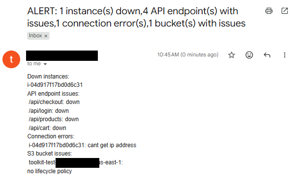

# DevOps Automation Toolkit

A small AWS automation tool I built to practice real-world DevOps/cloud skills. It checks EC2 health, reads application logs over SSH, checks API endpoints, and audits S3 buckets, then sends one email alert if anything needs attention and saves a report of the results.

I built this by simulating real client requests (not from a tutorial), one feature at a time, learning the Python/AWS concepts I needed as each feature actually required them.

**Status:** tested end to end on 20 October 2026 against a disposable AWS test environment (created and destroyed with Terraform). Screenshots and captions are in [`docs/proof/`](./docs/proof/captions.md). It was run from my laptop; the Lambda deployment below is the design target and has not been deployed yet.

## Architecture

```
EventBridge (every 5 min)
        ↓
   AWS Lambda
        ↓
Check tagged EC2 instances (state + CloudWatch status)
Check each instance's application log over SSH/SFTP (new errors since last check)
Check business-critical API endpoints (availability + response time)
Audit S3 buckets (public access, encryption, lifecycle policy, stale objects)
        ↓
Anything wrong?
        ↓
   Yes → send one alert email + save a report (JSON/CSV)
   No  → do nothing
```

Can also be run manually from the command line with flags to check just one thing at a time (see CLI section below).

---

## Proof it runs

I ran every check against real AWS, using a throwaway test stack (one tagged EC2 instance with a seeded log file, plus one S3 bucket). Highlights:

| Check | Result | Screenshot |
|---|---|---|
| Log monitoring | Found `ERROR payment failed for order 1002` over SSH and emailed it | [02](./docs/proof/02-email-log-error-alert.png) |
| Checkpointing | Second run stayed silent: old errors are not re-sent | [03](./docs/proof/03-logs-silent-checkpoint.png) |
| S3 audit | Flagged a bucket with no lifecycle policy | [04](./docs/proof/04-email-s3-audit.png) |
| API check | Reported 4 endpoints down (placeholder URL, expected) | [05](./docs/proof/05-email-api-check.png) |
| EC2 health | `ALERT: 1 instance(s) down` after stopping the instance | [06](./docs/proof/06-email-instance-down.png) |
| Full run | One combined email plus JSON/CSV reports | [07](./docs/proof/07-email-full-report.png), [08](./docs/proof/08-report-files.png) |
| Tests | 44 passed | [09](./docs/proof/09-pytest-passing.png) |



Full captions and what each screenshot proves: [docs/proof/captions.md](./docs/proof/captions.md). My email address and AWS account ID are covered in the images.

**A bug the real run caught:** the first run against a real server crashed with `TypeError: cannot use a string pattern on a bytes-like object`. Paramiko's SFTP file returns bytes, but my unit tests mocked the read to return a string, so they passed. I decoded the bytes in `read_new_log_lines` and added a regression test that feeds bytes.

---

## Feature 1: EC2 Health Check & Alert

**The problem:** the client had no way to know when a server went down except customers complaining. One outage went unnoticed for 3 hours.

**What it does:** checks every tagged EC2 instance every 5 minutes (instance state + CloudWatch status), and emails an alert if one goes down or becomes unhealthy.

**Notes on how it's built:**
- Designed to run on AWS Lambda + EventBridge instead of a dedicated server running cron: no server to maintain, and Lambda only costs money for the few seconds it actually runs.
- Instances are found by an AWS tag (`monitor: true`), not hardcoded IDs, so new servers get picked up automatically.
- Checks two things per instance (is it stopped? is CloudWatch reporting it healthy?) and combines them into one status: down / healthy / unhealthy.
- If checking one instance fails (AWS error, timeout, etc.), it's caught and logged instead of crashing the whole run. One bad instance doesn't stop the rest from being checked.
- A freshly launched instance has no status checks for about 5 minutes, so it is reported as an error until they initialize.

---

## Feature 2: Application Log Monitoring

**The problem:** the app itself can have real errors (like failed payments) that don't show up as an EC2 health issue at all.

**What it does:** for each tagged instance, gets its IP, connects over SSH, and reads its log file (`/var/log/app.log`), but only the *new* part since the last check, using a saved byte position (a "checkpoint") so it doesn't re-read the whole file every time. New lines containing "ERROR" get included in the alert email.

**Notes on how it's built:**
- Checkpoints are stored in one shared `checkpoints.json` file (`{instance_id: byte_position}`). Considered using a small database (SQLite) instead, but a plain JSON file is simpler and the downside (if it's ever lost, the next run just re-scans from the start) is low-risk for this use case.
- Reads the file over SFTP, which gives a file-like object I can `.seek()`/`.read()`/`.tell()` on, basically the same as reading a local file, which made it easier to reuse the checkpoint logic I'd already built. The SFTP read returns bytes, so it is decoded to text before filtering.
- If an instance can't be reached (no IP, bad SSH login, etc.), that's tracked *separately* from actual log errors. "Couldn't check this" and "found a real error" are different problems, and mixing them together made the alert logic confusing. A stopped instance has no public IP, so it shows up as a connection error.
- SSH connection is always closed in a `finally` block, so it closes even if something goes wrong mid-check.

---

## Feature 3: API Health Checker

**The problem:** the checkout API went down for ~20 minutes and nobody noticed until customers emailed support.

**What it does:** checks 4 endpoints (`/api/checkout`, `/api/login`, `/api/products`, `/api/cart`) every 5 minutes. Flags an endpoint as **down** if it errors out or fails to respond, or **slow** if it responds but takes 5+ seconds.

**Notes on how it's built:**
- One function (`check_endpoint`) checks both "did it respond" and "how long did it take" together, and returns one combined result (up/slow/down), the same pattern as the EC2 check.
- The 5-second "slow" threshold is a parameter with a default, not hardcoded, since the client wasn't even fully sure 5 seconds was the right number.
- Retries a failed request up to 3 times (waiting a bit longer each time) before actually calling it "down". A single dropped connection shouldn't trigger a false alarm.
- Every request has a timeout, so one hung endpoint can't stall the whole check.
- The base URL is currently a placeholder (`example.com`), so a real run reports every endpoint as down. Point it at a real service in `devops/api_monitoring.py`.

---

## Feature 4: S3 Bucket Auditor

**The problem:** none of the other checks say anything about cost or security risk sitting in storage: a public bucket, unencrypted data, or years of old files nobody's cleaning up.

**What it does:** checks every S3 bucket in the account for public access, missing encryption, and no lifecycle policy, and separately flags objects that haven't been touched in 90+ days.

**Notes on how it's built:**
- Same pattern as Feature 1: one function checks a single bucket and absorbs its own errors, returning either a list of problems found or `"error"`.
- AWS actually throws an error when a bucket has *no* policy/encryption/lifecycle rule set up at all (instead of just saying "not public" etc.). Those specific "not configured" errors are treated as a normal finding, not a real failure. Any other unexpected error still gets flagged as an actual error.
- Listing objects in a bucket only returns up to 1,000 at a time by default, with no warning if there's more, so I used boto3's paginator to make sure large buckets actually get fully checked instead of silently only checking the first page.
- Old objects are reported as a count ("42 old object(s)"), not a full list of filenames. A bucket with thousands of stale files would make the email unreadable otherwise.
- New S3 buckets are encrypted by default, so the "no encryption" finding is rare on modern buckets.

---

## Feature 5: Reporting (JSON/CSV)

**What it does:** after everything runs, saves the same results that went into the alert email as a timestamped `.json` and/or `.csv` file (`report_20260920_143022.json`), so there's a record beyond just the email.

**Notes on how it's built:**
- A new file gets created each run rather than appending to one growing file: simpler, and avoids one big file getting messy or corrupted over time.
- CSV output uses Python's `csv` module properly (not just dumping JSON text into a `.csv` file, which I did by mistake at first), so each line becomes its own row.

---

## CLI Interface

The tool can be run from the command line with flags instead of always checking everything:

```bash
python main.py --check ec2
python main.py --check logs
python main.py --check api
python main.py --check s3
python main.py --check all          # default
python main.py --check ec2 --format json   # only save JSON, not CSV
```

`--check` and `--format` are separate flags on purpose: one controls *what* gets checked, the other controls *how* results get saved. I originally tried cramming both into one flag, which meant picking `--check json` would run zero actual checks and produce an empty, useless report.

---

## One Combined Alert System

All four checking features report into a single dictionary passed to `send_alert_email()`, instead of the function needing a new parameter every time a feature gets added:

```python
alert_data = {
    "down": [...],
    "unhealthy": [...],
    "instance_errors": [...],
    "log_errors": {...},
    "connection_errors": {...},
    "api_errors": {...},
    "bucket_object_check": {...}
}
```

One email only gets sent if at least one of these actually has something in it; the subject line says `ALERT` if any EC2 instance is down, otherwise `Warning`.

---

## Tech Stack

- Python 3
- `boto3` (AWS SDK: EC2 and S3)
- `paramiko` (SSH/SFTP for reading logs)
- `requests` (HTTP calls for the API checker)
- AWS Lambda + EventBridge (scheduling, deployment target)
- AWS IAM (least-privilege read-only access)
- `smtplib` (sending the alert email)
- `python-dotenv` (loading settings locally)
- `argparse` (CLI)
- `pytest` + `unittest.mock` (testing)
- Terraform (disposable test environment)

## Setup

See [SETUP.md](./SETUP.md) for AWS credentials (SSO), Gmail app password, SSH key, and environment variable setup.

```bash
python -m venv .venv
source .venv/bin/activate   # Windows: .venv\Scripts\activate
pip install -r requirements.txt
cp .env.example .env        # fill in real values
python main.py
```

Required environment variables: `ALERT_EMAIL_FROM`, `ALERT_EMAIL_PASSWORD`, `ALERT_EMAIL_TO`, `SSH_USERNAME`, `SSH_KEY_PATH`

AWS credentials come from your AWS profile (for example `aws sso login`), not from `.env`.

## Testing

Everything is tested with mocked AWS, SSH, HTTP, and file calls. No real AWS account, SSH access, or live servers are needed to run the tests.

```bash
pip install pytest
pytest -v
```

**44 tests across 7 files:**
- `test_ec2_monitoring.py` (5): instance status logic (down/healthy/unhealthy/error) and the sorting across multiple instances
- `test_log_monitoring.py` (11): error filtering, checkpoint read/write, SSH log reading (including a simulated auth failure and bytes from the real SFTP library), and the full log-checking flow including an instance with no IP
- `test_api_monitoring.py` (7): up/slow/down states, retries (both giving up after 3 tries and succeeding on a retry), and the filtering logic
- `test_s3_monitoring.py` (13): each bucket check (public/encryption/lifecycle), the "not configured" vs. "real error" distinction, pagination across multiple pages of objects, and the overall bucket orchestration
- `test_formatting.py` (4): alert body formatting and the "is there anything to report" check
- `test_lambda_function.py` (3): the Lambda handler reads the check from the event, defaults to `all`, and rejects invalid values
- `test_utils.py` (1): the shared tagged-instance lookup

(Reporting doesn't have tests yet. It's simple file-writing logic and was deprioritized given time constraints.)

## Test environment (Terraform)

[`toolkit-test-infra/`](./toolkit-test-infra/) builds a disposable environment so the toolkit can be tried against real AWS without touching real systems:
- one `t3.micro` EC2 instance tagged `monitor=true`, with a log file containing an `ERROR` line
- a generated SSH key and a security group that allows SSH from one IP only
- one S3 bucket for the auditor to find

```bash
cd toolkit-test-infra
terraform init
terraform apply -var="my_ip_cidr=YOUR.IP.HERE/32"
# ...run the toolkit...
terraform destroy -var="my_ip_cidr=YOUR.IP.HERE/32"
```

It costs roughly a cent per hour while running and is destroyed the same day. See `toolkit-test-infra/RUNBOOK.md` for the full test sequence.

## Deployment (AWS Lambda)

Not deployed yet. This is the plan:

1. Build the package with Linux wheels for `paramiko` and `requests` (they are not in the Lambda runtime), and add `lambda_function.py` plus the `devops/` folder:
   `pip install paramiko requests --platform manylinux2014_x86_64 --only-binary=:all: --target package`
2. Create the Lambda function (handler `lambda_function.lambda_handler`, timeout 60 seconds, 256 MB) with a role that has EC2 read-only and S3 read access.
3. Set the alert email environment variables in the Lambda console.
4. Add EventBridge rules, one per check, with a constant input such as `{"check": "s3"}`, on `rate(5 minutes)`.

**Limit:** the `ec2`, `s3` and `api` checks work from Lambda. The SSH log check does not, unless the function runs in a VPC that can reach the instances (which adds NAT cost) and the key is stored securely. I run the log check locally. Pushing logs to CloudWatch Logs instead of pulling them over SSH would be the better long-term design.

## Things I'd still improve

- Make the API base URL and endpoint list configurable instead of hardcoded
- Configurable "how long down before alerting" threshold, to cut down on noise from short blips
- Send application logs to CloudWatch Logs instead of reading them over SSH, so the log check can run in Lambda
- Maybe move checkpoints to a small database instead of a JSON file if this ever needs to scale to a lot more instances
- Proper SSH host key checking (currently auto-accepts, which is convenient but not great security practice)
- Tests for the reporting module
- CI (GitHub Actions) to run the test suite automatically on every push

## What I learned building this

- Mocking (`unittest.mock`) lets you fully test code that talks to AWS/SSH/HTTP without needing any of those things to actually be running, which makes tests fast and free. But a mock only returns what you tell it to: my tests passed while the real SFTP library returned bytes, and the first real run crashed. Passing tests are not the same as proof, so I ran it for real and added a regression test.
- Small design decisions ripple outward more than expected: adding one new error category to track meant updating three or four different functions, not just one.
- Client requirements are rarely complete on the first message. Almost every feature needed a follow-up question or two before I actually understood what was being asked.
- Estimating how long something will take is a real skill on its own, separate from being able to build it, and early on a lot of "build time" is actually "learning time," which is worth being honest about instead of pretending otherwise.
- Cloud APIs often cap what they return per call (S3 only returns 1,000 objects at a time) and won't necessarily warn you. You have to know to check for that.
- Testing against real infrastructure is cheap when it's code: one `terraform apply` to create the test environment and one `terraform destroy` to remove it.
